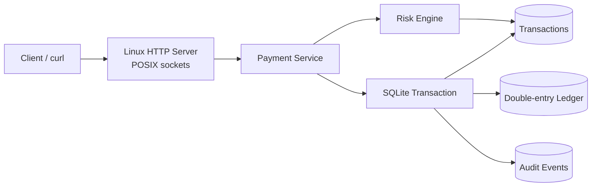

# AtlasPay — Linux/C++ Financial Services Engine

AtlasPay is a PayPal/Coinbase-inspired backend project written in **modern C++20** for **Linux**. It demonstrates the core systems concerns behind a payment or wallet platform: atomic balance updates, a double-entry ledger, idempotent APIs, risk controls, durable storage, validation, auditability, testing, containerization, and service deployment.

> Portfolio and education project only. AtlasPay is not a licensed payment processor, exchange, bank, brokerage, or production custody system.

## Highlights

- **Double-entry transfer ledger:** every transfer creates an equal debit and credit.
- **Integer money representation:** monetary values use 64-bit minor units instead of floating-point arithmetic.
- **Atomic persistence:** SQLite transactions prevent partial money movement.
- **Idempotency:** retried or concurrent duplicate deposits and transfers cannot duplicate funds.
- **Risk controls:** per-transfer, rolling 24-hour, velocity, account-state, and currency checks.
- **Validation invariants:** rejects malformed owners, currencies, amounts, account references, and invalid transaction-history requests.
- **Cross-currency protection:** direct transfers between different currencies are rejected because AtlasPay does not currently implement an FX engine.
- **Linux-native service:** POSIX sockets, `SIGINT`/`SIGTERM`, systemd hardening, and Docker support.
- **Engineering quality:** CMake, automated tests, GitHub Actions CI, sanitizer builds, and warning-clean compilation.

## Architecture



At a high level:

```text
Client request
      |
      v
HTTP server
      |
      v
PaymentService
      |
      +---- validation
      |
      +---- idempotency
      |
      +---- risk evaluation
      |
      v
Database transaction
      |
      +---- accounts
      +---- transactions
      +---- ledger entries
      +---- audit events
```

## API

| Method | Route | Purpose |
|---|---|---|
| `GET` | `/healthz` | Health check |
| `POST` | `/v1/accounts` | Create an account |
| `GET` | `/v1/accounts/{id}` | Read account and current balance |
| `POST` | `/v1/accounts/{id}/freeze` | Freeze an account |
| `POST` | `/v1/deposits` | Credit an account idempotently |
| `POST` | `/v1/transfers` | Transfer funds atomically |
| `GET` | `/v1/accounts/{id}/transactions` | Read bounded transaction history |

Amounts are represented in **minor units**.

For USD:

```text
2500 = $25.00
100000 = $1,000.00
```

## Core financial invariants

AtlasPay treats correctness as a set of invariants that must hold before and after every money movement.

### Account validation

- account owner names cannot be empty;
- whitespace-only owner names are rejected;
- owner names are bounded in length;
- currency codes must contain exactly three alphabetic characters;
- currencies are normalized to uppercase.

Examples:

```text
Alice / usd     -> accepted as USD
Bob / USD       -> accepted
Carol / US      -> rejected
Dave / US1      -> rejected
Eve / U$D       -> rejected
"   " / USD     -> rejected
```

### Amount validation

Deposits and transfers must contain strictly positive amounts.

```text
deposit +1000   -> accepted
deposit 0       -> rejected
deposit -1000   -> rejected

transfer +1000  -> accepted
transfer 0      -> rejected
transfer -1000  -> rejected
```

### Account existence

AtlasPay rejects requests referencing nonexistent accounts.

Examples include:

- reading an unknown account;
- depositing to an unknown account;
- transferring from an unknown account;
- transferring to an unknown account.

### Self-transfer protection

A transfer cannot use the same account as both source and destination.

```text
Alice -> Bob      accepted
Alice -> Alice    rejected
```

### Currency consistency

AtlasPay currently does not contain a foreign-exchange conversion engine.

Therefore:

```text
USD -> USD    accepted
EUR -> EUR    accepted
USD -> EUR    rejected
EUR -> USD    rejected
```

This prevents a value such as `1000` USD minor units from being silently interpreted as `1000` EUR minor units.

### Frozen-account protection

Frozen accounts cannot participate in normal money movement.

AtlasPay validates account state before processing deposits or transfers.

### Transaction-history bounds

Transaction-history requests are bounded to prevent malformed or excessively large database queries.

A request limit must remain within the supported range.

## Build on Ubuntu/Linux

Install dependencies:

```bash
sudo apt-get update
sudo apt-get install -y build-essential cmake libsqlite3-dev curl
```

Configure:

```bash
cmake -S . -B build -DCMAKE_BUILD_TYPE=Release
```

Build:

```bash
cmake --build build --parallel
```

Run tests:

```bash
ctest --test-dir build --output-on-failure
```

A successful run should report:

```text
100% tests passed
```

## Build on macOS

Install dependencies:

```bash
brew install cmake sqlite3
```

Configure:

```bash
cmake -S . -B build \
  -DCMAKE_BUILD_TYPE=Release
```

Build:

```bash
cmake --build build --parallel
```

Run tests:

```bash
ctest --test-dir build --output-on-failure
```

AtlasPay is designed primarily as a Linux service, but macOS is useful as a local development environment.

## Run the service

Start AtlasPay:

```bash
ATLASPAY_DB_PATH=./atlaspay.db \
ATLASPAY_BIND=127.0.0.1 \
ATLASPAY_PORT=8080 \
./build/atlaspay_server
```

The server listens on:

```text
127.0.0.1:8080
```

Check service health:

```bash
curl http://127.0.0.1:8080/healthz
```

Run the demonstration script from another terminal:

```bash
chmod +x scripts/demo.sh
./scripts/demo.sh
```

## Example requests

### Create an account

```bash
curl -X POST http://127.0.0.1:8080/v1/accounts \
  -H 'Content-Type: application/json' \
  -d '{
    "owner":"Alice",
    "currency":"USD"
  }'
```

### Deposit $1,000.00

```bash
curl -X POST http://127.0.0.1:8080/v1/deposits \
  -H 'Content-Type: application/json' \
  -d '{
    "account_id":"acct_REPLACE_ME",
    "amount_minor":100000,
    "idempotency_key":"deposit-alice-20260719-0001"
  }'
```

### Transfer $25.00

```bash
curl -X POST http://127.0.0.1:8080/v1/transfers \
  -H 'Content-Type: application/json' \
  -d '{
    "source_account_id":"acct_SOURCE",
    "destination_account_id":"acct_DESTINATION",
    "amount_minor":2500,
    "idempotency_key":"transfer-20260719-0001"
  }'
```

## Idempotency

Idempotency is one of the most important reliability guarantees in AtlasPay.

A payment client may retry a request because of:

- network timeouts;
- connection failures;
- process restarts;
- delayed responses;
- user retries.

Without idempotency, a retry could duplicate money movement.

AtlasPay associates money-moving operations with an idempotency key.

### Same key and same request

The original transaction is returned.

```text
deposit(account=A, amount=1000, key=abc12345)
deposit(account=A, amount=1000, key=abc12345)

Result:
one deposit
```

### Same key and different request

The request is rejected as a conflict.

```text
deposit(account=A, amount=1000, key=abc12345)
deposit(account=A, amount=2000, key=abc12345)

Result:
conflict
```

Concurrent requests using the same valid idempotency key are also tested to ensure funds are not duplicated.

## Risk policy

Default limits are configured through `RiskLimits`.

The system supports controls such as:

- maximum single transfer amount;
- maximum rolling 24-hour outgoing amount;
- maximum number of outgoing transfers in a velocity window;
- source account status;
- destination account status;
- currency compatibility.

Example default-style configuration:

```text
Maximum single transfer:
1,000,000 minor units

Maximum rolling 24-hour outgoing:
2,500,000 minor units

Maximum outgoing transfers per velocity window:
5
```

The risk engine evaluates a transfer before the database commits the ledger mutation.

## Double-entry ledger

AtlasPay models transfers using a double-entry-style ledger.

For a transfer of 2,500 minor units:

```text
Alice account: -2500
Bob account:   +2500
---------------------
Net change:        0
```

This preserves a fundamental accounting invariant:

```text
total debit = total credit
```

The transaction and its ledger entries are persisted atomically so AtlasPay cannot commit only one side of a transfer.

## Atomicity

Financial operations should be all-or-nothing.

For example:

```text
BEGIN TRANSACTION

debit Alice
credit Bob
record transaction
record ledger entries
record audit event

COMMIT
```

If an operation fails before completion:

```text
ROLLBACK
```

This prevents partially completed transfers.

## Concurrency

Financial APIs may receive multiple requests simultaneously.

AtlasPay includes synchronization around money-moving service operations and regression coverage for concurrent idempotent transfer requests.

The intended invariant is:

```text
8 concurrent identical requests
            |
            v
1 financial transaction
```

rather than:

```text
8 concurrent identical requests
            |
            v
8 duplicated transfers
```

## Testing

The test suite covers core financial and service invariants, including:

- account creation;
- currency normalization;
- invalid currencies;
- empty account owners;
- whitespace-only account owners;
- deposits;
- deposit idempotency;
- changed-payload idempotency conflicts;
- zero and negative amounts;
- successful transfers;
- self-transfer rejection;
- cross-currency rejection;
- insufficient funds;
- per-transfer risk limits;
- frozen-account behavior;
- missing-account behavior;
- concurrent idempotency;
- transaction-history behavior.

Run:

```bash
ctest --test-dir build --output-on-failure
```

## Sanitizers

AtlasPay supports AddressSanitizer and UndefinedBehaviorSanitizer builds.

Configure:

```bash
cmake -S . -B build-sanitize \
  -DCMAKE_BUILD_TYPE=Debug \
  -DATLASPAY_ENABLE_SANITIZERS=ON
```

Build:

```bash
cmake --build build-sanitize --parallel
```

Test:

```bash
ctest --test-dir build-sanitize --output-on-failure
```

Generated CMake build directories are excluded from Git so machine-specific `CMakeCache.txt` files are never reused in CI.

## Continuous integration

GitHub Actions runs automated checks on pull requests.

The CI workflow includes:

```text
source checkout
      |
      +--> Release build
      |       |
      |       +--> CTest
      |
      +--> sanitizer build
              |
              +--> CTest
```

This helps catch:

- compilation failures;
- regression-test failures;
- undefined behavior;
- memory-safety issues;
- environment-specific build problems.

## Docker

Build the container:

```bash
docker build -t atlaspay .
```

Run:

```bash
docker run \
  --rm \
  -p 8080:8080 \
  -v atlaspay-data:/var/lib/atlaspay \
  atlaspay
```

## systemd

Create a dedicated service account:

```bash
sudo useradd \
  --system \
  --home /var/lib/atlaspay \
  --create-home \
  atlaspay
```

Install the server:

```bash
sudo install \
  -m 0755 \
  build/atlaspay_server \
  /usr/local/bin/atlaspay_server
```

Install the systemd unit:

```bash
sudo install \
  -m 0644 \
  deploy/atlaspay.service \
  /etc/systemd/system/atlaspay.service
```

Reload systemd:

```bash
sudo systemctl daemon-reload
```

Enable and start AtlasPay:

```bash
sudo systemctl enable --now atlaspay
```

Inspect:

```bash
sudo systemctl status atlaspay
```

## Repository layout

```text
.
├── .github/
│   └── workflows/              # GitHub Actions CI
│
├── deploy/
│   └── atlaspay.service        # Linux systemd unit
│
├── docs/
│   └── architecture.md         # Architecture and extension notes
│
├── include/
│   └── atlaspay/
│       ├── database.hpp
│       ├── http_server.hpp
│       ├── models.hpp
│       ├── payment_service.hpp
│       └── risk_engine.hpp
│
├── scripts/
│   └── demo.sh                 # Reproducible API demonstration
│
├── src/
│   ├── database.cpp
│   ├── http_server.cpp
│   ├── main.cpp
│   ├── payment_service.cpp
│   └── risk_engine.cpp
│
├── tests/
│   └── payment_service_tests.cpp
│
├── .clang-format
├── .gitignore
├── CMakeLists.txt
├── Dockerfile
├── LICENSE
└── README.md
```

## Design principles

AtlasPay is organized around several engineering principles.

### Correctness before convenience

Money movement is validated before persistence.

### Explicit invariants

Important assumptions are encoded in C++ checks and regression tests rather than documentation alone.

### Integer arithmetic for money

Floating-point values are avoided for account balances and transaction amounts.

### Idempotent external operations

A network retry must not become a duplicated financial transaction.

### Atomic state mutation

Related balance and ledger updates belong to one database transaction.

### Bounded APIs

Requests such as transaction-history retrieval are constrained to predictable resource usage.

### Reproducible builds

CMake, CI, Docker, and ignored generated artifacts help keep local and remote builds consistent.

## Security and production boundaries

AtlasPay demonstrates backend and systems design. It intentionally does not claim production payment compliance.

A production financial platform would additionally require:

- authenticated users;
- authorization and account ownership controls;
- TLS everywhere;
- secrets management;
- KYC workflows;
- AML monitoring;
- sanctions screening;
- transaction reconciliation;
- encrypted backups;
- encryption at rest;
- key management;
- distributed tracing;
- metrics and alerting;
- structured centralized logging;
- disaster recovery;
- high-availability database architecture;
- data-retention controls;
- rate limiting;
- abuse prevention;
- PCI-DSS scoping where applicable;
- independent penetration testing;
- formal operational controls.

## Potential future extensions

Possible next engineering directions include:

- PostgreSQL-backed persistence;
- connection pooling;
- authentication and authorization;
- REST framework integration;
- structured JSON logging;
- metrics and tracing;
- rate limiting;
- asynchronous request processing;
- foreign-exchange conversion;
- multi-currency ledger support;
- transaction reversal support;
- reconciliation jobs;
- distributed idempotency storage;
- optimistic concurrency control;
- typed database error handling;
- fuzz testing;
- load testing.

## Resume-ready description

> Built a Linux financial-services engine in C++20 with atomic SQLite transactions, double-entry ledger semantics, idempotent deposits and transfers, integer-based money representation, account and currency validation, velocity and volume risk controls, concurrency-safe request handling, POSIX HTTP serving, systemd deployment, Docker packaging, and GitHub Actions CI with sanitizer testing.

## Disclaimer

AtlasPay is a portfolio project intended to demonstrate software engineering, backend systems, C++, Linux, databases, testing, and financial-system design concepts.

It must not be used to process real customer funds or provide regulated financial services.

## License

MIT
