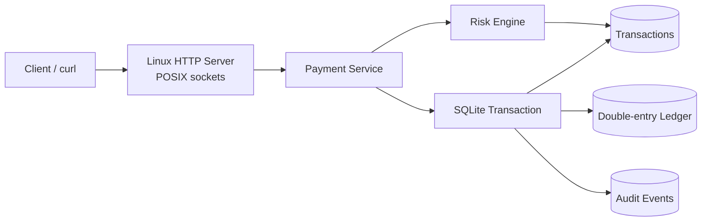

# AtlasPay — Linux/C++ Financial Services Engine

AtlasPay is a PayPal/Coinbase-inspired backend project written in **modern C++20** for **Linux**. It demonstrates the core systems concerns behind a payment or wallet platform: atomic balance updates, a double-entry ledger, idempotent APIs, fraud controls, durable storage, auditability, tests, containerization, and service deployment.

> Portfolio/education project only. It is not a licensed payment processor, exchange, bank, or production custody system.

## Highlights

- **Double-entry transfer ledger:** every transfer creates an equal debit and credit.
- **Integer money representation:** amounts use 64-bit minor units rather than floating point.
- **Atomic persistence:** SQLite transactions prevent partial transfers.
- **Idempotency:** retried deposits/transfers cannot duplicate funds.
- **Risk checks:** per-transfer, rolling 24-hour, velocity, account-state, and currency controls.
- **Linux-native service:** POSIX sockets, `SIGINT`/`SIGTERM`, systemd hardening, Docker support.
- **Engineering quality:** CMake, unit/integration tests, GitHub Actions, sanitizer job, warning-clean builds.

## Architecture



## API

| Method | Route | Purpose |
|---|---|---|
| `GET` | `/healthz` | Health check |
| `POST` | `/v1/accounts` | Create an account |
| `GET` | `/v1/accounts/{id}` | Read account and balance |
| `POST` | `/v1/accounts/{id}/freeze` | Freeze an account |
| `POST` | `/v1/deposits` | Credit an account idempotently |
| `POST` | `/v1/transfers` | Transfer funds atomically |
| `GET` | `/v1/accounts/{id}/transactions` | Read transaction history |

Amounts are in **minor units**. For USD, `2500` means `$25.00`.

## Build on Ubuntu/Linux

```bash
sudo apt-get update
sudo apt-get install -y build-essential cmake libsqlite3-dev curl

cmake -S . -B build -DCMAKE_BUILD_TYPE=Release
cmake --build build --parallel
ctest --test-dir build --output-on-failure
```

Run the service:

```bash
ATLASPAY_DB_PATH=./atlaspay.db \
ATLASPAY_BIND=127.0.0.1 \
ATLASPAY_PORT=8080 \
./build/atlaspay_server
```

In another terminal:

```bash
./scripts/demo.sh
```

## Example requests

Create an account:

```bash
curl -X POST http://127.0.0.1:8080/v1/accounts \
  -H 'Content-Type: application/json' \
  -d '{"owner":"Alice","currency":"USD"}'
```

Deposit `$1,000.00`:

```bash
curl -X POST http://127.0.0.1:8080/v1/deposits \
  -H 'Content-Type: application/json' \
  -d '{
    "account_id":"acct_REPLACE_ME",
    "amount_minor":100000,
    "idempotency_key":"deposit-alice-20260719-0001"
  }'
```

Transfer `$25.00`:

```bash
curl -X POST http://127.0.0.1:8080/v1/transfers \
  -H 'Content-Type: application/json' \
  -d '{
    "source_account_id":"acct_SOURCE",
    "destination_account_id":"acct_DESTINATION",
    "amount_minor":2500,
    "idempotency_key":"transfer-20260719-0001"
  }'
```

## Idempotency behavior

The same idempotency key and payload returns the original transaction. The same key with a changed account or amount returns HTTP `409 Conflict`. This models a critical payment-system invariant: client retries must not create duplicate money movement.

## Risk policy

Default limits are configured in `RiskLimits`:

- maximum single transfer: `1,000,000` minor units;
- maximum rolling 24-hour outgoing amount: `2,500,000` minor units;
- maximum outgoing transfers per 60 seconds: `5`;
- source and destination accounts must be active;
- currencies must match.

## Docker

```bash
docker build -t atlaspay .
docker run --rm -p 8080:8080 -v atlaspay-data:/var/lib/atlaspay atlaspay
```

## systemd

```bash
sudo useradd --system --home /var/lib/atlaspay --create-home atlaspay
sudo install -m 0755 build/atlaspay_server /usr/local/bin/atlaspay_server
sudo install -m 0644 deploy/atlaspay.service /etc/systemd/system/atlaspay.service
sudo systemctl daemon-reload
sudo systemctl enable --now atlaspay
sudo systemctl status atlaspay
```

## Repository layout

```text
.
├── include/atlaspay/       # Public C++ interfaces
├── src/                    # Database, risk, service, and HTTP implementation
├── tests/                  # End-to-end core service tests
├── scripts/demo.sh         # Reproducible curl demonstration
├── deploy/atlaspay.service # Hardened Linux systemd unit
├── docs/architecture.md    # Design and production-extension notes
├── .github/workflows/      # Build, test, and sanitizer CI
├── CMakeLists.txt
└── Dockerfile
```

## Security and production boundaries

This repository demonstrates system design; it intentionally does not claim production payment compliance. A production system would also require authenticated users, authorization, TLS, secrets management, KYC/AML workflows, sanctions screening, reconciliation, encrypted backups, key management, observability, disaster recovery, data-retention controls, PCI-DSS scoping, and independent security review.

## Resume-ready description

> Built a Linux-based financial services engine in C++20 with atomic SQLite transactions, a double-entry ledger, idempotent deposits/transfers, integer-based money representation, velocity and volume risk controls, POSIX HTTP serving, systemd deployment, Docker packaging, and GitHub Actions CI with sanitizer testing.

## License

MIT
